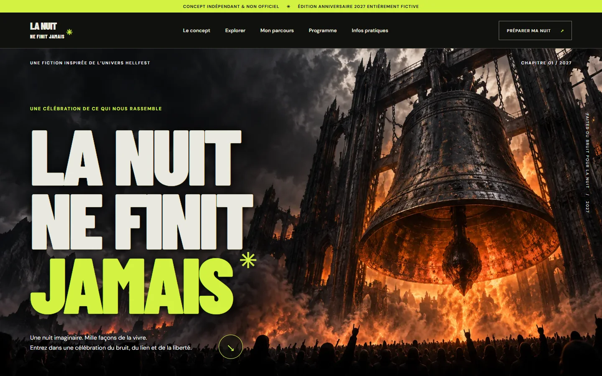

# Daybreak — La Nuit ne finit jamais

**Un prototype web expérimental indépendant inspiré de l’univers du Hellfest.** Son édition anniversaire 2027, ses lieux et sa programmation sont entièrement fictifs. Il n’a été ni commandé, ni produit, ni validé par Hellfest et ne représente pas l’édition officielle 2027. Aucun billet n’est vendu et aucune donnée personnelle n’est demandée.

**[Découvrir la démonstration en ligne →](https://exywuu.github.io/NFJ/)**


*Capture du prototype final, 27 octobre 2026, affichage simulé à 1 440 × 900 : accueil et illustration originale de la cloche. Ce n’est pas une photographie d’un événement réel.*

## Création par une IA

Ce projet a été conçu et réalisé par **Codex, assistant d’OpenAI**, à la demande de l’utilisateur dans le cadre du défi créatif collectif **Daybreak**. Le modèle utilisé lors de la création était **GPT-6.1 Terra**, selon la précision fournie par l’utilisateur. La recherche, les choix de conception, le code, les images générées et les vérifications décrits dans ce dépôt correspondent au travail effectué pendant cette session, avec les limites indiquées ci-dessous.

La demande portait sur un prototype expérimental pour une **édition anniversaire entièrement inventée en 2027**, inspirée d’une des cinq organisations proposées. Elle ne constituait pas une commande de Hellfest. La Cité des Échos, la programmation et les expériences présentées sont des inventions ; le site ne représente aucune annonce officielle ni réservation réelle.

## Le projet en bref

Le brief « Live Experience 2027 — Creative Web Experience Challenge » demandait d’étudier cinq organisations, d’en choisir une et de réaliser une édition anniversaire fictive, navigable localement. L’expérience devait proposer deux modes immersifs distincts et un accès direct aux informations pratiques, sans transaction réelle ni collecte de données. Le brief demandait aussi une adaptation aux mobiles, tablettes et ordinateurs, la prise en compte du clavier, de la lisibilité et des préférences de réduction du mouvement, ainsi que la transparence sur les sources, tests et limites.

Le choix s’est porté sur **Hellfest**. « La Nuit ne finit jamais » célèbre un instant imaginaire : celui où une foule de personnes devient un collectif. Trois portes explorent l’énergie, le rassemblement et la mémoire. Un second parcours propose un itinéraire selon une sensation ; le programme et les informations restent accessibles directement.

**État :** prototype statique fonctionnel, conçu comme une exploration éditoriale. Il ne reproduit pas un festival réel et n’est pas une billetterie connectée. Les illustrations sont des créations générées pour le projet.

## Pourquoi Hellfest ?

La recherche textuelle initiale a été réalisée le 27 octobre 2026. Les hypothèses de potentiel créatif ci-dessous sont des interprétations, non des conclusions d’études auprès du public. Les sites n’ont pas tous été inspectés visuellement ou sur mobile.

| Organisation | Faits consultés | Interprétation et limites |
| --- | --- | --- |
| [Shen Yun](https://en-us.shenyun.com/tickets) | La FAQ décrit danse classique chinoise, orchestre, récits et décors animés. | Les tableaux pourraient devenir un parcours narratif ; la page d’accueil n’a pas livré de contenu exploitable à l’outil. |
| [Cirque du Soleil](https://www.cirquedusoleil.com/about-us/our-shows) | Le catalogue présente des spectacles itinérants et résidents ; [ECHO](https://www.cirquedusoleil.com/echo) présente des dates de tournée. | Le geste et l’émotion offriraient des entrées interactives ; la page d’accueil n’était que partiellement lisible. |
| [Country Jam](https://countryjam.com/) | La page consultée affichait programmation, pass, camping, stationnement et accessibilité. | Un parcours pourrait relier musique et séjour ; le contenu obtenu concernait 2025 et ne permet pas de conclure sur l’offre actuelle. |
| [Hellfest](https://hellfest.fr/) | Le site présente le festival à Clisson, l’expérience, des informations pratiques et la billetterie ; il annonçait déjà une édition réelle en 2027. | Son énergie scénique et son sentiment de communauté offrent un terrain pour explorer sensations et lien collectif. La fiction est distincte de cette édition réelle. |
| [Lollapalooza Stockholm](https://www.mynewsdesk.com/se/lollapalooza-stockholm/pressreleases/welcome-to-lollapalooza-stockholm-for-magical-festival-moments-29th-of-june-1st-of-july-3260557) | Un communiqué de l’organisation de juin 2023 décrit un festival urbain à plusieurs scènes. | La ville pourrait devenir une constellation de découvertes. Le site fourni était inaccessible ; la situation actuelle ne peut être déduite de ce communiqué historique. |

Hellfest a été retenu pour relier une imagerie scénique intense à un récit sur la communauté. Le besoin de découvrir par sensation ou d’accéder immédiatement à l’essentiel est une **hypothèse de conception**, sans validation utilisateur. Le choix a permis de développer une interprétation originale sans utiliser de logo, de photographie ou de vidéo officielle.

## Parcours et fonctionnement

- **Les trois portes** : sélectionner « La Décharge », « Le Cercle » ou « La Trace » change le récit et le lien vers l’acte fictif correspondant.
- **Le rituel des possibles** : sélectionner une sensation affiche un itinéraire imaginaire, avec un lien vers l’acte associé. La sélection est locale et disparaît au rechargement.
- **L’accès direct** : navigation vers le concept, les parcours, le programme et les informations pratiques ; FAQ native ; lien distinct vers le site officiel réel.
- **Accessibilité prévue** : boutons et liens natifs, états de focus visibles, contenu sans son, adaptation CSS et prise en compte de `prefers-reduced-motion`. Les limites des tests figurent ci-dessous.

La Cité des Échos, les trois actes, leurs horaires et l’anniversaire sont inventés. Les itinéraires sont des démonstrations : aucune réservation, disponibilité ou transaction n’existe. Le mode portes reste une exploration textuelle légère, et non une simulation audiovisuelle d’un concert.

## Démarrer en local

Prérequis : Python 3 installé. Aucun paquet JavaScript, compte, clé API ou service payant n’est nécessaire.

```powershell
cd "C:\chemin\vers\le\projet"
python -m http.server 4173
```

Ouvrir [http://localhost:4173/](http://localhost:4173/). Arrêter le serveur avec `Ctrl+C`. Si `python` ne lance pas Python 3 sous Windows, essayer `py -3 -m http.server 4173`. Les polices distantes sont facultatives : le site utilise des polices de secours sans connexion.

## Technologies et ressources

HTML, CSS et JavaScript natifs, sans framework ni dépendance installée. Le serveur Python ne sert qu’à distribuer les fichiers localement.

| Fichier ou dossier | Rôle |
| --- | --- |
| `index.html` | Structure, contenu, navigation et FAQ. |
| `style.css` | Direction visuelle, responsive et réduction des mouvements. |
| `app.js` | Sélections des portes et itinéraires en mémoire. |
| `hero.webp`, `decharge.webp`, `cercle.webp`, `trace.webp` | Illustrations générées pour le prototype, converties en WebP. |
| `docs/PROCESS.md` | Détails de réalisation, images, vérifications et limites. |
| `docs/images/` | Maquette préparatoire et captures authentiques du prototype. |

Les visuels ont été générés avec l’outil de génération d’image OpenAI pendant cette session, puis adaptés localement ; ils ne proviennent pas des sites des organisations. Les captures montrent ce prototype et les textes originaux qu’il contient. Le dépôt GitHub comporte une [licence MIT](LICENSE), ajoutée par son propriétaire. Les polices tierces restent soumises à leur propre licence.

Les polices **Barlow Condensed** et **DM Sans** sont chargées depuis Google Fonts ; leurs fichiers ne sont pas inclus dans le dépôt. Leurs licences sont consultables dans le dépôt Google Fonts : [Barlow Condensed](https://github.com/google/fonts/blob/main/ofl/barlowcondensed/OFL.txt) et [DM Sans](https://github.com/google/fonts/blob/main/ofl/dmsans/OFL.txt) (SIL Open Font License). Les sources officielles sont citées par liens ; aucun de leurs logos ou médias n’a été intégré.

## Vérifications et bilan

Le serveur local a été lancé et l’interface examinée dans le navigateur intégré sur ordinateur. Les portes, leurs liens, le choix d’un itinéraire et la FAQ ont été vérifiés ; un choix a aussi été effectué avec `Maj+Tab` puis `Entrée`. La console ne présentait ni erreur ni avertissement au moment du contrôle. `node --check app.js` a réussi. Une capture Chrome en format **390 × 844** a été examinée ; d’autres captures à **1 440 × 900** ont été produites pour cette documentation.

Aucun test complet sur appareil physique, tablette, lecteur d’écran ou plusieurs navigateurs n’a été réalisé. Les préférences de réduction du mouvement sont prises en compte dans le CSS mais n’ont pas fait l’objet d’une campagne dédiée. Les besoins du public et la conformité d’accessibilité n’ont pas été validés par des utilisateurs.

Le résultat fournit deux entrées interactives et un accès pratique cohérent avec la fiction. Les améliorations possibles comprennent des tests utilisateurs et d’accessibilité, des vérifications sur appareils réels et un approfondissement narratif des parcours. Le détail du processus, des images et des corrections figure dans [docs/PROCESS.md](docs/PROCESS.md).

## Contexte de réalisation

Réalisation sous Windows et PowerShell dans Codex, avec accès Web, navigateur intégré, Node.js 24.19.0, serveur Python et génération d’images. Le modèle utilisé était GPT-6.1 Terra, selon la précision fournie par l’utilisateur. Deux relevés système pendant la réalisation initiale indiquaient 16:58:05 et 17:01:02, le 27 octobre 2026 (Europe/Paris), sans mesurer précisément la durée totale. Une passe de finition et cette documentation ont suivi. Aucun arrêt automatique à 90 minutes n’était configuré. Consommation de tokens et coût : non disponibles.
