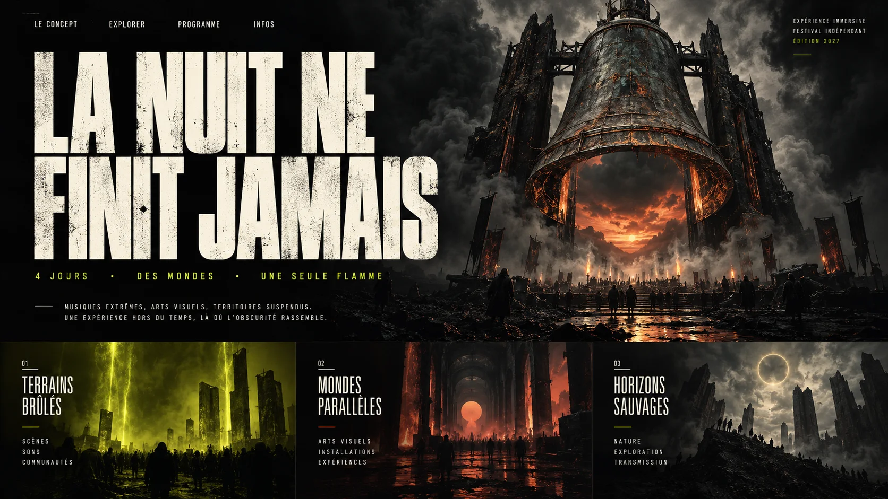
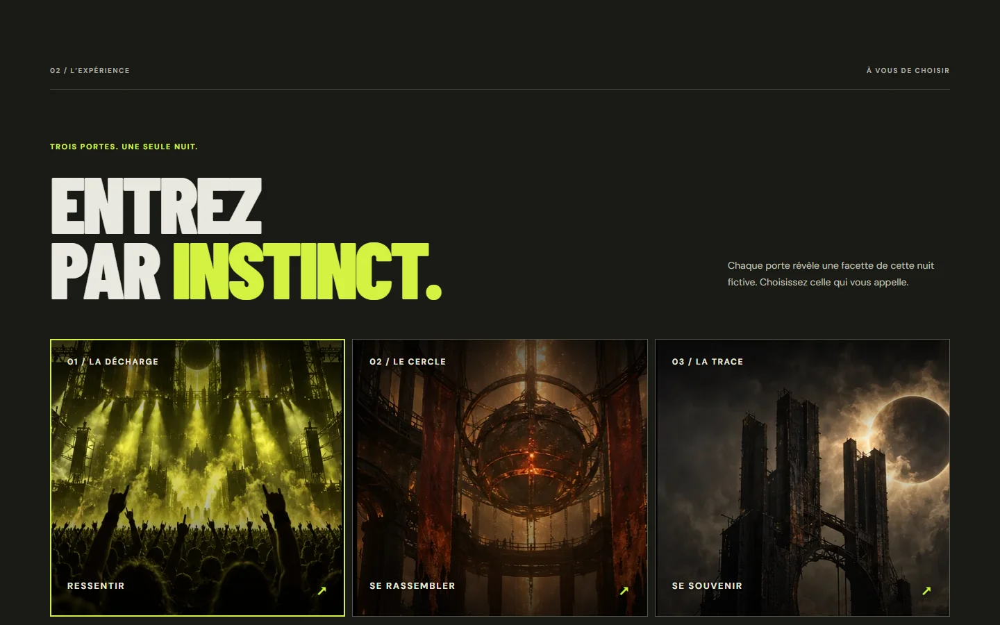
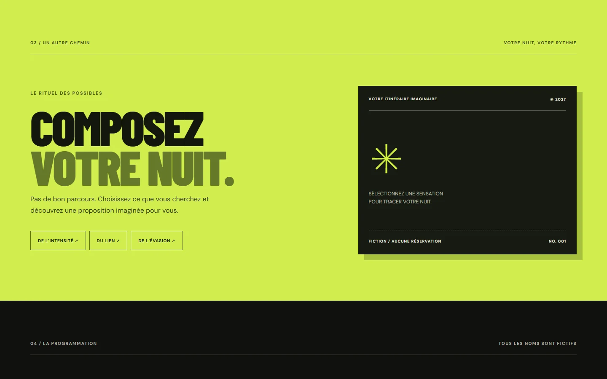
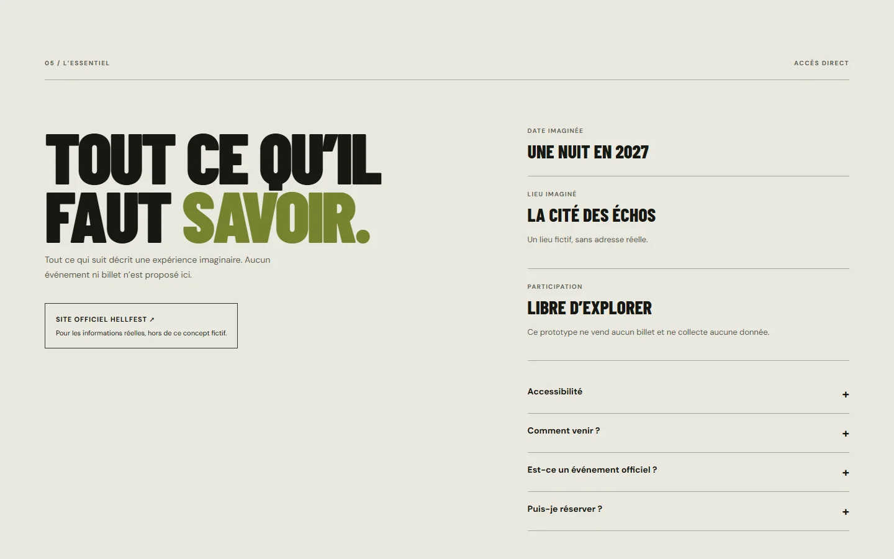
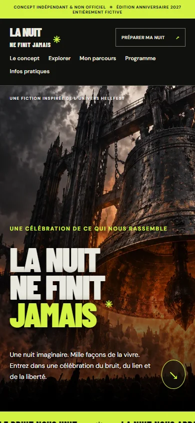

# Daybreak — dossier de réalisation

Ce document complète le [README](../README.md). Il retrace les décisions et vérifications documentées dans la session, sans prétendre reconstituer un journal chronométré complet. Les visuels sont des fichiers locaux référencés par des chemins relatifs.

## 1. Demande et contraintes

Le brief reçu demandait une recherche sur cinq organisations de spectacle et de festival, une sélection argumentée, puis une édition anniversaire 2027 inventée. La réalisation devait proposer une expérience immersive principale, une seconde forme de découverte et un accès pratique direct. Les contraintes incluaient le fonctionnement local, les formats mobile/tablette/ordinateur, le clavier, la réduction des mouvements, l’absence de transaction et de collecte de données, et une mention explicite de non-officialité. La cible était un maximum de 90 minutes de travail effectif ; aucun chronomètre complet ou arrêt automatique n’était disponible.

La comparaison et les sources sont dans le README. L’étude reposait sur les contenus textuels accessibles : elle n’établit pas un audit graphique ou mobile complet des cinq sites.

## 2. Choix et direction

Hellfest a été choisi pour la possibilité de relier une esthétique scénique sombre à l’idée d’une communauté. La proposition « La Nuit ne finit jamais » transpose cette idée en trois moments imaginaires : l’énergie d’une scène, un rassemblement circulaire et les souvenirs après le bruit. Il s’agit d’une hypothèse créative, sans entretiens ni validation du public.

La direction repose sur un noir charbon, des caractères condensés clairs, un accent jaune-vert et des images industrielles. Le texte et les commandes sont réalisés en HTML ; la fiction n’utilise ni logo ni photographie officielle. Le premier parcours sélectionne une porte et révèle son récit ; le second associe une sensation à une proposition d’itinéraire. Le programme et les renseignements sont accessibles sans terminer ces parcours.

## 3. Maquette préparatoire

*Maquette préparatoire générée le 27 octobre 2026 avant la rédaction du prototype. Elle propose une cloche monumentale, une typographie condensée et trois territoires visuels. C’est une piste de conception, pas une capture du site ni une annonce réelle.*

Cette image a servi de référence visuelle générale. Le site final conserve la cloche, le contraste sombre et les trois entrées, mais n’est pas une reproduction exacte de la maquette : le titre est disposé sur trois lignes, une mention de fiction visible a été ajoutée, le contenu et les noms des portes ont été réécrits et l’expérience comprend un parcours personnel ainsi qu’une section pratique. La mention « 4 jours » visible dans la maquette est une proposition générée non retenue ; elle ne décrit ni le prototype final ni une édition officielle. Aucun croquis, moodboard distinct, wireframe ou schéma d’architecture préalable n’a été conservé.

Une image séparée, générée ensuite pendant le développement, a fourni la cloche sans texte utilisée dans `hero.webp`. Un triptyque d’ambiances a été généré lors de la passe de finition, puis découpé en trois images WebP pour les portes. Les ressources graphiques finales sont des créations générées pour ce projet.

## 4. Résultat et captures

*Capture du prototype final, 27 octobre 2026, Chrome via Playwright, fenêtre simulée 1 440 × 900 : accueil. L’image montre le rendu du site, pas un événement réel.*

*Capture du prototype final, 27 octobre 2026, Chrome via Playwright, fenêtre simulée 1 440 × 900 : section d’exploration des portes, dans son état initial.*

*Capture du prototype final, 27 octobre 2026, Chrome via Playwright, fenêtre simulée 1 440 × 900 : rituel des possibles avant sélection d’une sensation.*

*Capture du prototype final, 27 octobre 2026, Chrome via Playwright, fenêtre simulée 1 440 × 900 : accès aux renseignements et à la FAQ de la fiction.*

*Capture du prototype final, 27 octobre 2026, Chrome via Playwright, fenêtre simulée 390 × 844 : premier écran mobile. Il ne s’agit pas d’une photographie d’un appareil physique.*

Les captures ont été enregistrées pour la documentation après réalisation. Elles montrent des états initiaux ; les interactions ont été vérifiées séparément dans le navigateur, sans qu’une capture de chaque état sélectionné ait été conservée.

## 5. Étapes réalisées et corrections

1. Lecture du brief et consultation textuelle des sources pour les cinq candidats ; choix de Hellfest et distinction de sa véritable édition 2027.
2. Génération d’une maquette de direction, puis écriture du prototype en HTML, CSS et JavaScript. La première version utilisait un motif abstrait programmatique à l’accueil et des symboles pour les portes.
3. Génération d’une image originale sans texte pour l’accueil ; conversion en WebP et intégration au prototype. Les premiers contrôles ont confirmé le changement de récit d’une porte, l’itinéraire collectif et l’ouverture de la FAQ.
4. Passe de finition à la demande : génération du triptyque pour les portes, renforcement du contraste sur mobile, ajout d’un accès direct au parcours personnel et liens menant aux actes correspondants. Un retour à la ligne mobile a aussi été corrigé.
5. Contrôle final : navigation vers une porte, sélection du Cercle et vérification du récit et de la cible ; sélection d’Évasion et vérification de l’itinéraire ; contrôle de la console et capture de l’accueil mobile. Cette documentation et les captures desktop ont été créées ensuite, sans modification du prototype.

La maquette et les captures ne constituent pas une preuve de recherche utilisateur ou de validation d’une organisation. Aucun partenaire ou soutien officiel n’est revendiqué.

## 6. Vérifications réellement effectuées

| Vérification | Résultat observé | Portée et limites |
| --- | --- | --- |
| Serveur local | `python -m http.server 4173` et chargement du site. | Test local seulement. |
| Syntaxe | `node --check app.js` sans erreur. | Ne garantit pas l’absence de tous les défauts. |
| Portes | Sélections du Cercle et de la Trace ; récit et lien vers l’acte correspondant modifiés. | Les états ont été observés dans le navigateur intégré. |
| Parcours personnel | Choix « du lien » et « de l’évasion » ; itinéraire et lien adaptés. Un choix a été effectué via `Maj+Tab` et `Entrée`. | Ce n’est pas un audit complet de navigation clavier. |
| FAQ | Ouverture de la réponse sur la non-officialité. | Les autres entrées n’ont pas chacune fait l’objet d’une vérification consignée. |
| Console | Aucun avertissement ni erreur au moment du contrôle. | Navigateur intégré ; observation ponctuelle. |
| Affichage | Desktop observé ; capture complète et premier écran en 390 × 844 sous Chrome via Playwright ; captures desktop en 1 440 × 900. | Fenêtres simulées, pas d’appareils physiques ; pas de test tablette consigné. |
| Réduction du mouvement | Règle CSS `prefers-reduced-motion` présente. | Pas de test dédié consigné avec la préférence activée. |

Aucun test avec lecteur d’écran, audit automatisé complet d’accessibilité, test utilisateur, mesure de performance ou test multi-navigateurs complet n’a été consigné. Les polices hébergées peuvent ne pas charger hors ligne ; les polices de secours restent utilisables. La billetterie et les transports réels ne sont pas implémentés, conformément au caractère fictif.

## 7. Ressources et droits

- La maquette, la cloche et les trois portes ont été générées avec l’outil de génération d’image OpenAI au cours de la session. Les fichiers utilisés dans le site ont été convertis en WebP ; le triptyque a été découpé. Les captures sont issues du prototype local.
- [Barlow Condensed](https://github.com/google/fonts/blob/main/ofl/barlowcondensed/OFL.txt) et [DM Sans](https://github.com/google/fonts/blob/main/ofl/dmsans/OFL.txt) sont des polices Google Fonts sous SIL Open Font License ; elles sont appelées à distance et ne sont pas redistribuées comme fichiers dans le projet.
- Les sites des organisations servent de sources liées dans le README ; leurs médias propriétaires ne sont pas reproduits.
- Le dépôt GitHub comporte une [licence MIT](../LICENSE), ajoutée par son propriétaire. Les polices tierces conservent leur propre licence.

## 8. Éléments non disponibles

Durée complète précisément mesurée, consommation de tokens, coût, version exacte du modèle, capture de chaque interaction dans son état sélectionné, résultats d’une étude utilisateur et résultats de tests sur appareils physiques ne sont pas disponibles. Les horaires système relevés durant la première passe sont des repères partiels, et non une mesure de durée totale.
